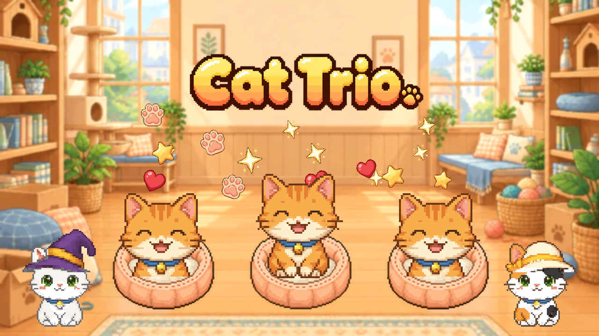
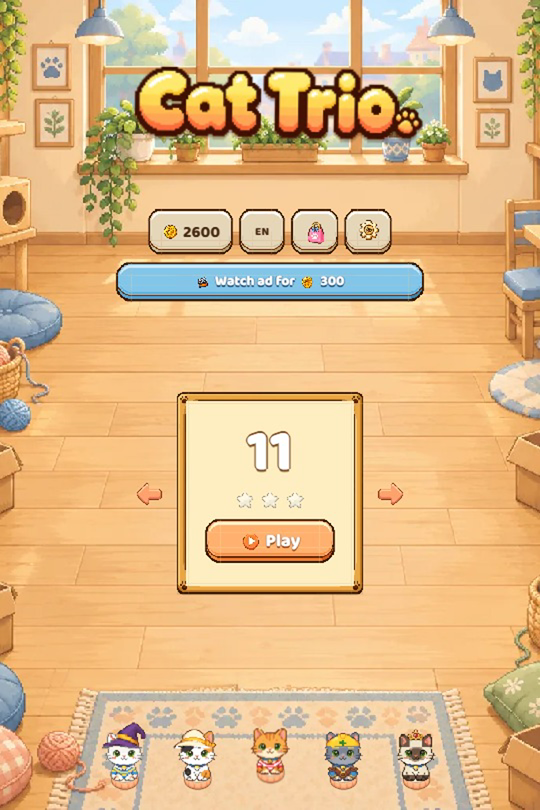
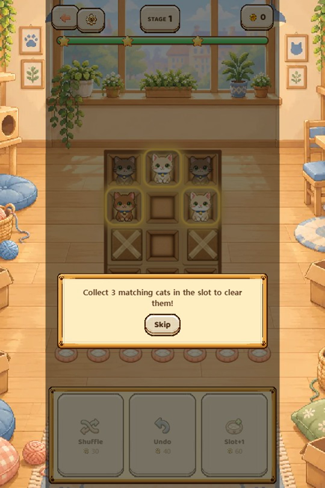
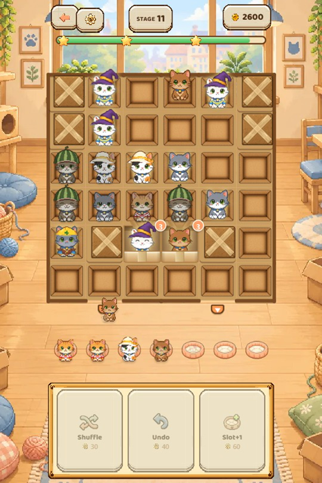
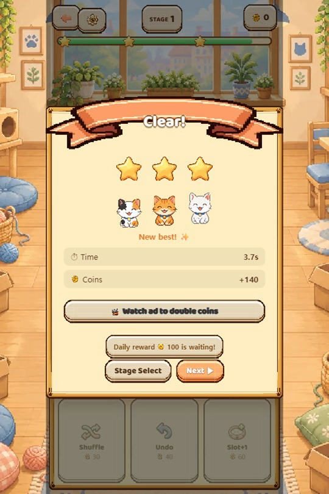
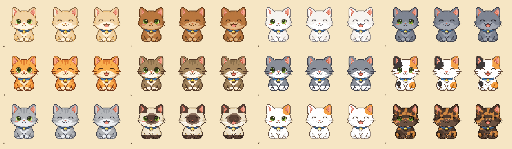
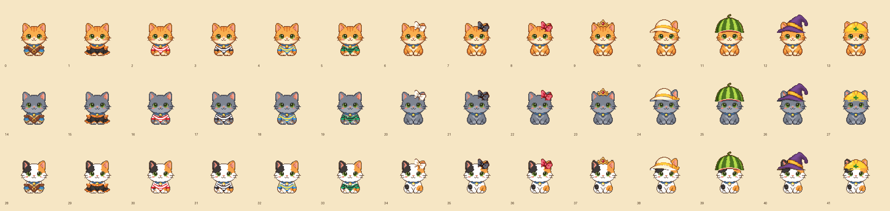

# Cat Trio 🐾

골판지 상자 미로에 갇힌 고양이를 탈출구로 내보내고, 같은 고양이 셋을 방석에 모아 없애는 퍼즐 게임 (Verse8 / Vite + TypeScript).



| 스테이지 선택 | 튜토리얼 | 큰 판 | 클리어 |
|---|---|---|---|
|  |  |  |  |

## 규칙

- 고양이는 **빈 칸을 4방향으로 지나 탈출구에 닿을 수 있을 때만** 나간다. 누를 수 있는 고양이는 빛난다.
- 나온 고양이는 아래 방석(기본 7칸)에 앉고, 같은 종류 3마리가 모이면 활짝 웃으며 사라진다.
- 방석이 다 차거나 시간이 끝나면 실패. 남은 시간으로 별 1~3개.
- 아이템: 셔플 · 되돌리기 · 방석 +1 (코인). 코인은 클리어와 보상형 광고로.
- 코스튬 14종(옷 6 · 모자 8)을 고양이 12종에 입힐 수 있고, 입힌 모습 그대로 판에 나온다.

## 그림 (2026-11 개편)

고양이 12종 × 표정 3개(기본 · 눈 감기 · 활짝 웃음):



코스튬 (주황 · 회색 · 삼색):



- 고양이·코스튬·아이콘·패널: PixelLab 픽셀아트. 털색 12종은 한 장의 기본 고양이를 색만 바꿔 만들었다.
- 모자는 귀가 챙 밖으로 나오거나 가려지므로 털색별 "모자 쓴 고양이" 스프라이트를 따로 구워 둔다 (`game/public/hats/`).
- 스프라이트 형식: 96px 프레임 3장 띠(288×96). 고양이 몸은 프레임 안 64px, 위·옆 여백은 모자 자리 (`game/src/assets.ts`).
- 배경음·효과음: PixelLab (카페 테마 루프, 냐옹 효과음). 합성음 폴백 없음.
- 화면은 세로 480×1000, 창이 넓으면 가로 1000×620 2단(왼쪽 미로판 · 오른쪽 방석·아이템)으로 바뀐다 (`game/src/layout.ts`).

## 개발

```bash
npm install
npm run dev
npm run build      # 서버 빌드 + vite build
```

- `game/` — 클라이언트 (Vite root), `server/` — Verse8 게임서버(랭킹 · 클라우드 세이브)
- 상점: VX 코인 상품(`@verse8/platform`), 광고: `@verse8/ads`
- `game/src/reskin.css` 가 `style.css` 위에 그림 UI(9-slice 패널·버튼)를 덮는다.
